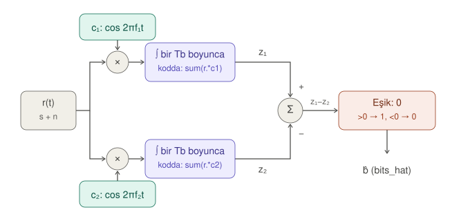

# docs

Project proposal, progress notes, final report and presentation.

## Figures

- `figures/bfsk_correlation_receiver.svg` (+ `.png`): BFSK correlation receiver block diagram — r(t) is correlated with cos(2πf₁t) and cos(2πf₂t) over one bit period, and the sign of z₁ − z₂ gives the bit decision (matches the correlator loop in the BFSK script).

