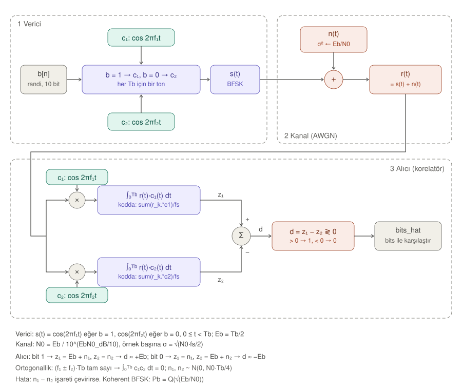
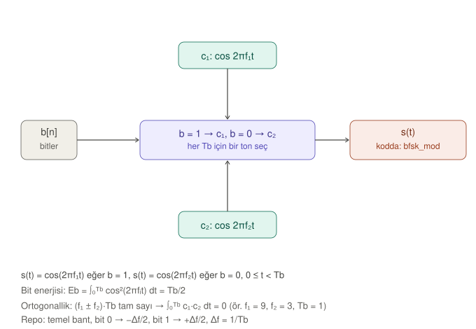
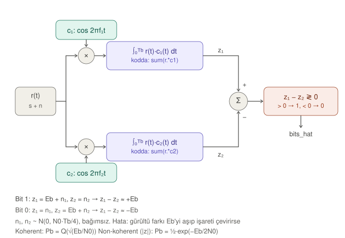

# BFSK (Binary Frequency Shift Keying)

Her bit bir frekansla gönderilir: 1 → $f_1$, 0 → $f_2$. Bilgi genlikte değil, **frekansta** taşınır.

| Dosya | İçerik |
|---|---|
| `bfsk_sistem.svg` / `.png` | Verici + AWGN kanal + alıcı tek şekilde |
| `bfsk_verici.svg` / `.png` | Verici: bit değerine göre iki tondan birini seçme |
| `bfsk_alici.svg` / `.png` | Alıcı: iki korelatör, $z_1 - z_2$ ve sıfır eşiği |
| `bfsk_adim_adim.m` | Öğretici MATLAB script: 10 rastgele bit → verici → kanal → korelatör → karar, her adım yorumlu ve grafikli |

## 0. Bütün sistem



`bfsk_adim_adim.m` bu diyagramı bölüm bölüm takip eder: `%% 1) VERİCİ`, `%% 2) KANAL`, `%% 3-4) ALICI`, `%% 5) KARAR`, `%% 6) SONUÇ`.

## 1. Verici



```math
s(t) = \begin{cases} \cos(2\pi f_1 t), & b = 1 \\ \cos(2\pi f_2 t), & b = 0 \end{cases} \qquad 0 \le t < T_b
```

Bit enerjisi:

```math
E_b = \int_0^{T_b}\cos^2(2\pi f_i t)\,dt = \frac{T_b}{2}
```

**Ortogonallik şartı.** $(f_1 \pm f_2)\,T_b$ tam sayı ise iki ton bir bit boyunca birbirini "görmez":

```math
\int_0^{T_b}\cos(2\pi f_1 t)\cos(2\pi f_2 t)\,dt = \frac12\int_0^{T_b}\big[\cos 2\pi(f_1-f_2)t + \cos 2\pi(f_1+f_2)t\big]dt = 0
```

Örnek: $f_1 = 9$ Hz, $f_2 = 3$ Hz, $T_b = 1$ s → $(f_1 - f_2)T_b = 6$, $(f_1 + f_2)T_b = 12$.

> Repodaki `bfsk_mod` bunun temel bant karşılığını kullanır: bit 0 → $-\Delta f/2$, bit 1 → $+\Delta f/2$, $\Delta f = 1/T_b$. Fikir aynıdır.

## 2. Kanal

```math
r(t) = s(t) + n(t), \qquad n(t): \text{beyaz Gauss, güç yoğunluğu } N_0/2
```

## 3. Alıcı – korelatör



Gelen bit parçası iki referansla çarpılıp bir bit boyunca integre edilir:

```math
z_1 = \int_0^{T_b} r(t)\cos(2\pi f_1 t)\,dt, \qquad z_2 = \int_0^{T_b} r(t)\cos(2\pi f_2 t)\,dt
```

$r = s + n$ yazınca, ortogonallik sayesinde:

| Gönderilen | $z_1$ | $z_2$ | $z_1 - z_2$ |
|---|---|---|---|
| bit 1 | $E_b + n_1$ | $n_2$ | $\approx +E_b$ |
| bit 0 | $n_1$ | $E_b + n_2$ | $\approx -E_b$ |

$n_1, n_2 \sim \mathcal{N}(0,\ N_0 T_b/4)$, birbirinden bağımsız.

Ayrık zamanda (kod): $z_i = \sum_n r[n]\,c_i[n]$. İntegraldeki $1/f_s$ çarpanı yok; karşılaştırmayı değiştirmez.

## 4. Karar

```math
\hat b = \begin{cases} 1, & z_1 - z_2 > 0 \\ 0, & z_1 - z_2 < 0 \end{cases}
```

Hata, gürültü farkı $n_1 - n_2$ işareti çevirecek kadar büyük olduğunda olur.

## 5. BER

| Alıcı | Teorik $P_b$ | Kodda |
|---|---|---|
| Koherent (faz biliniyor) | $Q\!\left(\sqrt{E_b/N_0}\right)$ | `bfsk_demod(r, sps, 'coherent')` |
| Non-koherent ($\lvert z_i\rvert$ karşılaştırılır) | $\tfrac12 e^{-E_b/2N_0}$ | `bfsk_demod(r, sps, 'noncoherent')` |

Ortogonal BFSK, aynı $E_b/N_0$'da QPSK'dan **3 dB** kötüdür: iki sinyal arası uzaklık $\sqrt{2E_b}$, QPSK'da (her kol) $2\sqrt{E_b}$.

## Kodda

| Adım | Fonksiyon |
|---|---|
| Verici | `src/bfsk_mod.m` |
| Kanal | `src/awgn_channel.m` |
| Alıcı + karar | `src/bfsk_demod.m` |
| Teori | `ber_theory('bfsk' / 'bfsk_coh', EbN0_dB)` |
