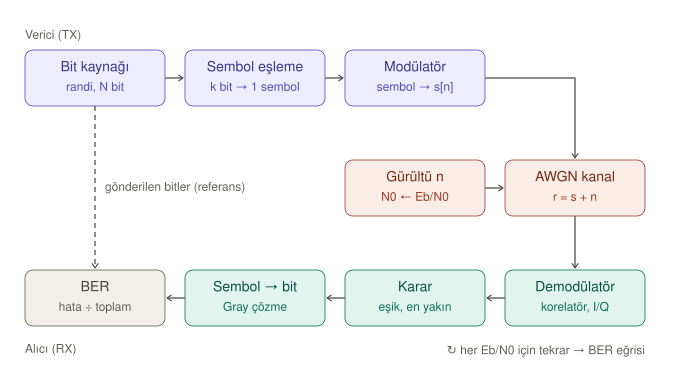
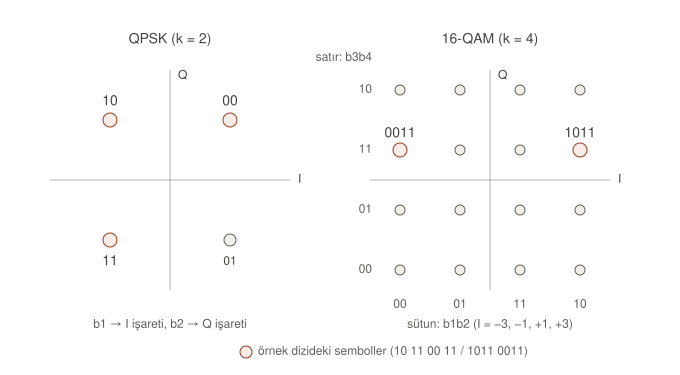

# Genel

Üç modülasyon için ortak şekiller.

| Dosya | İçerik |
|---|---|
| `end_to_end_ber_system.svg` / `.png` | Uçtan uca simülasyon zinciri: bitler → eşleme → modülatör → AWGN → demodülatör → karar → bitler → BER, her Eb/N0 için tekrar |
| `constellations_gray.svg` / `.png` | Gray kodlu QPSK ve 16-QAM yıldız diyagramları |

