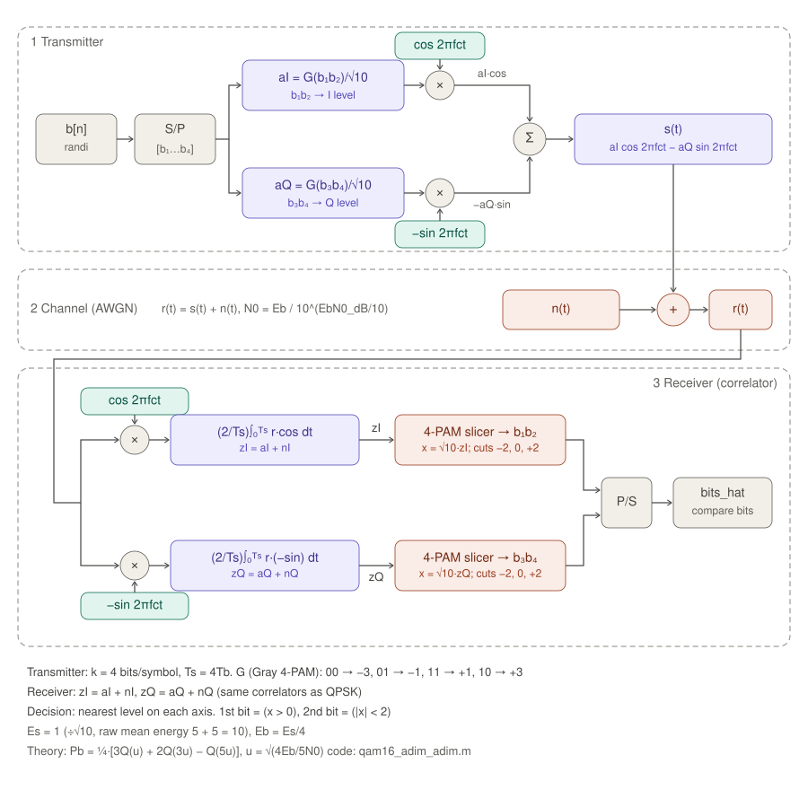
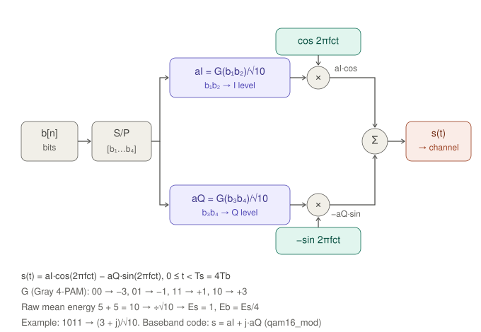
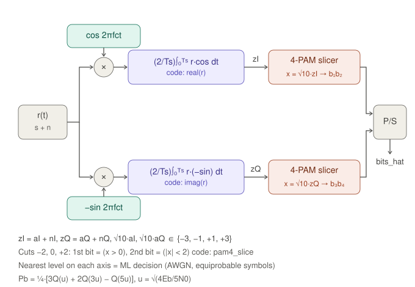
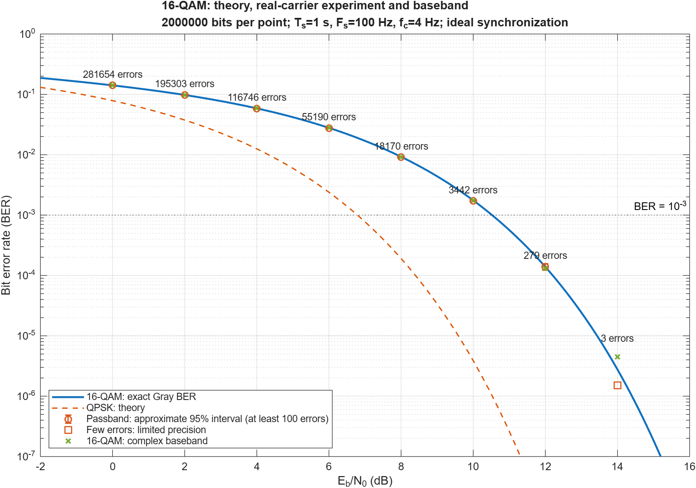
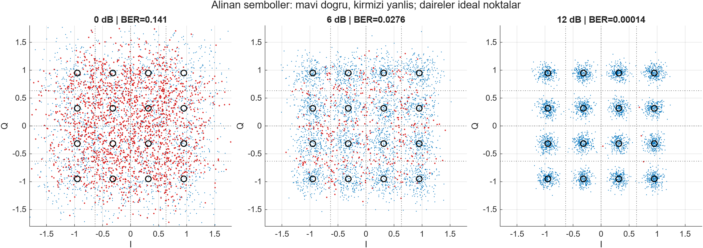
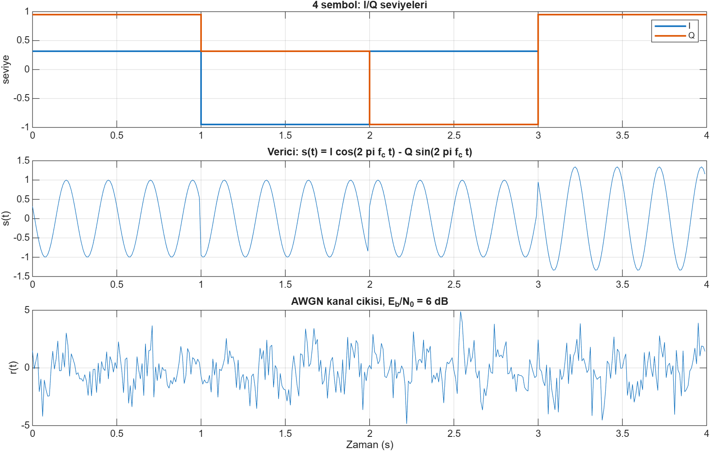

# 16-QAM: bitten taşıyıcıya, taşıyıcıdan bite

**16-QAM katkısı: Emir Dündar ([@Dundarzade](https://github.com/Dundarzade)).**

16-QAM, her sembolde **4 bit** taşıyan 16 noktalı bir modülasyondur. İlk iki bit I, son iki bit Q bileşeninin seviyesini seçer. Verici bu iki sayıyla analog taşıyıcının genliğini ve fazını belirler; alıcı gürültülü sinyalden aynı dört biti tahmin eder.

## Çalıştırma ve dosyalar

MATLAB çalışma klasörünü depo köküne getir:

```matlab
start_qam16                       % Etkileşimli 16-QAM deneyi
addpath('src');
out = qam16_experiment(40000, 6);  % Tek bir Eb/N0 noktasını koddan çalıştır
run_qam16_analysis               % BER, yıldız ve dalga biçimi çıktıları
```

Arayüzde varsayılan bit sayısı 40.000, karşılaştırılan $E_b/N_0$ değerleri 0, 6 ve 12 dB'dir. Yıldız diyagramında karar eşiklerini ve hatalı kararları, tabloda hata sayaçları ile BER/SER'i, bit hata şeridinde hatanın yerini incele. Bit sayısı 4'ün katı olmalıdır.

| Dosya | Görevi |
|---|---|
| [`../../start_qam16.m`](../../start_qam16.m) | Depo kökünden arayüzü açar |
| [`../../gui/qam16_gui.m`](../../gui/qam16_gui.m) | Üç gürültü düzeyini karşılaştıran arayüz |
| [`../../src/qam16_experiment.m`](../../src/qam16_experiment.m) | Gerçek taşıyıcı → AWGN → korelatör → karar deneyi |
| [`qam16_adim_adim.m`](qam16_adim_adim.m) | 12 bit/3 sembol üzerinden bütün zinciri açıklayan öğretici script |
| [`sunum_notlari.md`](sunum_notlari.md) | 2–3 dakikalık sunum akışı ve soru cevapları |
| [`qam16_sistem.svg`](qam16_sistem.svg) | Bitten bite bütün sistem |
| [`qam16_verici.svg`](qam16_verici.svg) | S/P, Gray 4-PAM ve I/Q taşıyıcıları |
| [`qam16_alici.svg`](qam16_alici.svg) | İki korelatör ve karar verici |

Gray etiketli yıldız diyagramı: [`../genel/constellations_gray.svg`](../genel/constellations_gray.svg).

## 1. Bütün sistem

<picture>
  <source media="(prefers-color-scheme: dark)" srcset="qam16_sistem_dark.svg">
  
</picture>

Zincir: **bitler → dörder gruplama → I/Q seviyeleri → taşıyıcı → gürültü → I/Q korelatörleri → en yakın nokta → bitler**. `qam16_adim_adim.m` dosyasındaki `%%` bölümleri bu sırayı izler. Scriptin bölümlerini baştan sona sırayla çalıştır; sonraki bölüm öncekinin değişkenlerini kullanır.

## 2. Verici: dört bit bir noktayı seçer

<picture>
  <source media="(prefers-color-scheme: dark)" srcset="qam16_verici_dark.svg">
  
</picture>

Her sembol $[b_1\ b_2\ b_3\ b_4]$ biçimindedir. Her eksende Gray kodlu 4-PAM eşlemesi kullanılır:

```math
G(00)=-3,\qquad G(01)=-1,\qquad G(11)=+1,\qquad G(10)=+3
```

```math
a=a_I+ja_Q=\frac{G(b_1b_2)+jG(b_3b_4)}{\sqrt{10}}
```

Tablodaki I ve Q **ham seviyelerdir**; gerçek nokta $(I+jQ)/\sqrt{10}$ olur.

| Bitler | I | Q | Bitler | I | Q |
|---|---:|---:|---|---:|---:|
| `0000` | −3 | −3 | `1000` | +3 | −3 |
| `0001` | −3 | −1 | `1001` | +3 | −1 |
| `0010` | −3 | +3 | `1010` | +3 | +3 |
| `0011` | −3 | +1 | `1011` | +3 | +1 |
| `0100` | −1 | −3 | `1100` | +1 | −3 |
| `0101` | −1 | −1 | `1101` | +1 | −1 |
| `0110` | −1 | +3 | `1110` | +1 | +3 |
| `0111` | −1 | +1 | `1111` | +1 | +1 |

Gray kodda yatay veya düşey en yakın komşular tek bitte farklıdır. Gürültü çoğunlukla bu komşulara kaydırdığında bit hatası azalır. Noktaların uzaklığı ve sembol hata olasılığı yalnız bit etiketlerini değiştirerek iyileşmez.

**Neden $\sqrt{10}$?** Eşit olasılıklı sembollerde her ham eksenin ortalama karesi $(9+1+1+9)/4=5$'tir. İki eksen toplamda 10 verir; $\sqrt{10}$'a bölmek $\mathbb{E}[|a|^2]=1$ yapar. Bu, bütün noktaların enerjisinin 1 olduğu anlamına gelmez; ortalamaları 1'dir.

Bir sembol boyunca, $T_s=4T_b$ olmak üzere:

```math
s(t)=a_I\cos(2\pi f_ct)-a_Q\sin(2\pi f_ct)
     =A\cos(2\pi f_ct+\phi),\quad
A=\sqrt{a_I^2+a_Q^2},\quad\phi=\operatorname{atan2}(a_Q,a_I)
```

Örneğin `1011` için $a=(3+j)/\sqrt{10}$, $A=1$ ve $\phi\approx18{,}435^\circ$ olur. Böylece dört sayısal bit, bir sembol süresince belirli genlik ve fazdaki analog dalgayla taşınır. 16 nokta, 16 ayrı genlik ve 16 ayrı faz demek değildir: kare 16-QAM'de üç farklı genlik vardır, $\sqrt{0{,}2}$, $1$ ve $\sqrt{1{,}8}$; bunlar farklı fazlarla birleşir.

## 3. Enerji ve AWGN: iki ölçeği ayır

`qam16_mod` yalnız karmaşık sembol üretir; bu gösterimde ortalama sembol enerjisi **1** kabul edilir. `qam16_experiment` ise bu katsayılarla **gerçek taşıyıcı örnekleri** üretir. Kullanılan cos/sin taşıyıcılarının bir semboldeki enerjisi $T_s/2$ olduğundan:

```math
E_s=\mathbb{E}\!\left[\int_0^{T_s}s^2(t)\,dt\right]
   =\frac{T_s}{2}\mathbb{E}[|a|^2]=\frac{T_s}{2},
\qquad E_b=\frac{E_s}{4}=\frac{T_s}{8}
```

Dolayısıyla $T_s=1$ için passband deneyinin ortalama $E_s=0{,}5$, $E_b=0{,}125$ değerleri, birim enerjili sembol gösterimiyle tutarlıdır. Bu değerler eşit olasılıklı sembol kümesinin ortalamasıdır; sonlu bir rastgele bit dizisinde ölçülen ortalama biraz farklı çıkabilir.

Kanala toplamsal beyaz Gauss gürültüsü (AWGN) eklenir:

```math
r[n]=s[n]+n[n],\qquad
\gamma_b=10^{(E_b/N_0)_{\mathrm{dB}}/10},\quad
N_0=\frac{E_b}{\gamma_b},\quad
n[n]\sim\mathcal{N}\!\left(0,\sigma^2\right),\quad
\sigma^2=\frac{N_0F_s}{2}
```

$N_0/2$ gerçek gürültünün iki taraflı güç spektral yoğunluğudur. Örnekleme hızı $F_s$ yükselince örnek başına varyans da yükselir; korelatördeki $1/F_s$ integrasyon adımı bu ölçeği dengeler. Bu yüzden taşıyıcı örneklerine, birim enerjili tek karmaşık sembolle aynı gürültü varyansını doğrudan ekleyemeyiz. Gerçek ve karmaşık sinyal gürültüsünün iki katsayısı farkı [MathWorks AWGN Channel açıklamasında](https://www.mathworks.com/help/comm/ref/awgnchannel.html) da ayrılır.

Deneyin varsayılanları `Ts=1`, `Fs=100`, `Fc=4`, `Seed=16`'dır. $F_sT_s$ tam sayı örnek sayısı, $f_cT_s$ tam sayı taşıyıcı periyodu olmalıdır; ayrıca $f_c<F_s/2$ gerekir. Böylece örneklenmiş cos ve −sin bir sembol boyunca diktir. Öğretici script aynı modeli daha sık örnekler (`fs=1000`).

## 4. Alıcı: iki korelatör ve karar

<picture>
  <source media="(prefers-color-scheme: dark)" srcset="qam16_alici_dark.svg">
  
</picture>

Alıcı, her sembol aralığında sinyali cos ve −sin ile çarpıp toplar:

```math
z_I=\frac{2}{T_s}\int_0^{T_s}r(t)\cos(2\pi f_ct)\,dt=a_I+n_I,
\qquad
z_Q=\frac{2}{T_s}\int_0^{T_s}r(t)[-\sin(2\pi f_ct)]\,dt=a_Q+n_Q
```

Kodda integral, örneklerin toplamının $1/F_s$ ile çarpımıdır. $2/T_s$ katsayısı taşıyıcıların enerjisini giderir ve alıcıyı tekrar modülatörün I/Q ölçeğine getirir. Her kolun çıkış gürültüsü varyansı $N_0/T_s=1/(8\gamma_b)$ olur; böylece temel banttaki birim enerji modeliyle aynı karar istatistiği elde edilir.

Ölçeği geri al: $x_I=\sqrt{10}\,z_I$, $x_Q=\sqrt{10}\,z_Q$. Her eksende en yakın $\{-3,-1,+1,+3\}$ seviyesi seçilir; ham eşikler $-2,0,+2$, yıldız diyagramındaki eşikler $\{-2,0,+2\}/\sqrt{10}$'dur.

```matlab
b1 = xI > 0;      b2 = abs(xI) < 2;
b3 = xQ > 0;      b4 = abs(xQ) < 2;
```

Bu, [`qam16_demod.m`](../../src/qam16_demod.m) içindeki `pam4_slice` kararının karşılığıdır. AWGN ve eşit olasılıklı sembollerde en yakın nokta, en yüksek olabilirlikli (ML) sembol kararıdır. Tam eşikteki bağlar kodun `>` ve `<` kurallarıyla çözülür; sürekli Gauss gürültüsünde bu olayın olasılığı sıfırdır.

Bu alıcı **ideal sembol zamanlaması ve taşıyıcı fazı/frekansı** bilir. Deney, bunları tahmin eden bir senkronizasyon devresi içermez.

## 5. BER, SER ve QPSK ile fark

BER, hatalı bit sayısının toplam bit sayısına oranıdır. SER, en az bir biti yanlış çözülen sembollerin toplam sembollere oranıdır. Bir sembol hatası birden fazla bit hatası doğurabilir; bu yüzden her koşulda `BER = SER/4` denemez.

Gray kodlu kare 16-QAM, eşit olasılıklı bitler, ideal eşzamanlı alıcı ve AWGN için tam BER:

```math
P_b=\frac{3Q(u)+2Q(3u)-Q(5u)}{4},\qquad
u=\sqrt{0{,}8\gamma_b},\qquad
Q(x)=\frac12\operatorname{erfc}\!\left(\frac{x}{\sqrt2}\right)
```

Yalnız yüksek $E_b/N_0$ için $P_b\approx\tfrac34Q(u)$ yaklaşımı kullanılır. Projedeki [`ber_theory('qam16', ...)`](../../src/ber_theory.m) tam ifadeyi kullanır. İfade, [MathWorks kare M-QAM BER ifadesinin](https://www.mathworks.com/help/comm/ug/analytical-expressions-used-in-berawgn-function-and-bit-error-rate-analysis-app.html) $M=16$ özel halidir.

16-QAM'de $R_b=4R_s$; QPSK'de $R_b=2R_s$'dir. Aynı bit hızında 16-QAM'in sembol hızı QPSK'nin yarısıdır. Aynı darbe şekillendirme ve roll-off kullanıldığında bu daha dar bant sağlar. Buradaki dikdörtgen sembol darbelerinin spektral yan lobları vardır; yalnız 4 bit/sembol bilgisinden kesin bir işgal edilen bant genişliği çıkarılmaz.

Karşılığı daha yüksek gürültü duyarlılığıdır. Teorik BER $10^{-3}$ için QPSK yaklaşık **6,8 dB**, 16-QAM yaklaşık **10,5 dB** ister: fark yaklaşık **3,7 dB**'dir. Bu değerler teori eğrilerinden hesaplanır; her BER düzeyinde sabit 4 dB fark olduğu anlamına gelmez.

## 6. Sonuçları üretme ve okuma

[`run_qam16_analysis.m`](../../src/run_qam16_analysis.m), `results/qam16/` altında yeniden üretilebilir simülasyon çıktıları oluşturur. Bunlar donanım ölçümü değildir. Sayısal sonucu hata sayısı ve bit sayısıyla birlikte [`qam16_ber.csv`](../../results/qam16/qam16_ber.csv) dosyasından oku; MATLAB verileri [`qam16_results.mat`](../../results/qam16/qam16_results.mat) içindedir.







$E_b/N_0$ arttıkça noktaların ideal konumların çevresinde sıkışmasını ve BER'in düşmesini bekleriz. Sonlu örnek sayısında simülasyon teoriyle birebir çakışmaz. Bir koşuda sıfır hata görmek gerçek BER'in sıfır olduğunu kanıtlamaz; yalnız o kadar bitte hata gözlenmediğini gösterir. Yüksek $E_b/N_0$ noktalarını yorumlarken daha çok bit gerekir.

Sıfır hata durumunda, $N_s$ bağımsız sembol için tek taraflı %95 SER üst sınırı $1-0{,}05^{1/N_s}$'dir. BER ≤ SER olduğundan bu aynı zamanda ihtiyatlı bir BER üst sınırıdır. Böylece aynı sembol içindeki bit hatalarını bağımsız saymak gerekmez.

## 7. ESP32'ye geçiş: henüz donanım ölçümü yok

[`hardware/README.md`](../../hardware/README.md) iki ESP32 arasında kablolu, düşük frekanslı modem için **taslak plandır**. MATLAB sonuçları bu donanımın çalıştığını veya donanım BER'ini göstermez.

16-QAM'i donanımda ayırmak için ADC/DAC genlik ölçeği, DC ofseti ve kanal kazancı kalibre edilmeli; doyum önlenmeli; taşıyıcı faz/frekansı ve sembol zamanlaması eşzamanlanmalıdır. Yalnız işarete bakan bir alıcı yeterli değildir: iç ve dış genlik seviyelerini de ayırmak gerekir.

Örnekleme planı ayrıca doğrulanmalıdır: klasik **ESP32** için **ESP-IDF v5.5.1**, `SOC_ADC_SAMPLE_FREQ_THRES_LOW` değerini **20 kHz** tanımlar. Bu nedenle plandaki 8 kHz, bu sürümün yerleşik ADC continuous sürücüsüne doğrudan verilebilen bir örnekleme hızı olarak kabul edilmemelidir. Daha yüksek hızda örnekleyip uygun filtreleme/seyreltme veya başka bir örnekleme yolu seçilmesi gerekir; kesin seçim kart ve sürücüyle test edilmelidir. Kaynak: [Espressif v5.5.1 ESP32 `soc_caps.h`](https://github.com/espressif/esp-idf/blob/v5.5.1/components/soc/esp32/include/soc/soc_caps.h).
