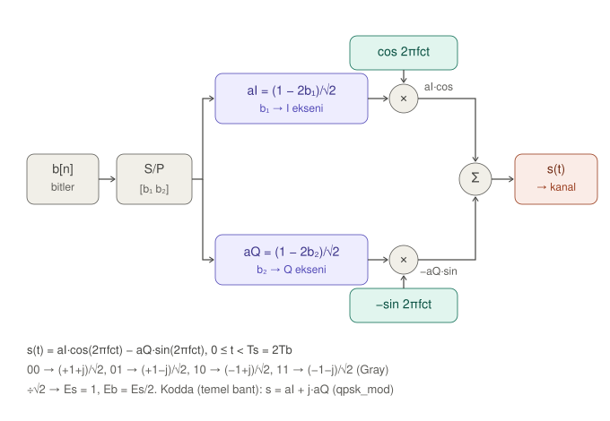
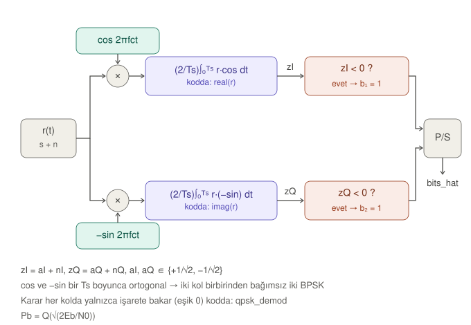

# QPSK (Quadrature Phase Shift Keying)

İki biti aynı anda gönderir: biri **I** (cos) eksenine, diğeri **Q** (−sin) eksenine. k = 2, M = 4.

| Dosya | İçerik |
|---|---|
| `qpsk_verici.svg` / `.png` | Verici: S/P, I/Q eşleme, cos / −sin taşıyıcılar |
| `qpsk_alici.svg` / `.png` | Alıcı: iki korelatör, her kolda işaret kararı |
| `qpsk_tam_sistem.svg` / `.png` | Verici + kanal + alıcı tek şekilde |

Gray etiketli yıldız diyagramı: [`../genel/constellations_gray.svg`](../genel/constellations_gray.svg)

## 1. Verici



Bitler ikişer gruplanır, $[b_1\ b_2]$:

```math
a_I = \frac{1 - 2b_1}{\sqrt2}, \qquad a_Q = \frac{1 - 2b_2}{\sqrt2}
```

| $b_1 b_2$ | 00 | 01 | 10 | 11 |
|---|---|---|---|---|
| $a_I + j a_Q$ | $\frac{1+j}{\sqrt2}$ | $\frac{1-j}{\sqrt2}$ | $\frac{-1+j}{\sqrt2}$ | $\frac{-1-j}{\sqrt2}$ |

Komşu noktalar tek bitte farklıdır (Gray). $\sqrt2$'ye bölmek $E_s = 1$, $E_b = E_s/2$ yapar.

Bir sembol süresi $T_s = 2T_b$ boyunca:

```math
s(t) = a_I\cos(2\pi f_c t) - a_Q\sin(2\pi f_c t)
```

> Kodda temel bant kullanılır: $s = a_I + j a_Q$, sembol başına 1 örnek. Taşıyıcıya çıkıp geri inmek AWGN'de BER'i değiştirmez.

## 2. Kanal

```math
r(t) = s(t) + n(t)
```

## 3. Alıcı – iki korelatör



```math
z_I = \frac{2}{T_s}\int_0^{T_s} r(t)\cos(2\pi f_c t)\,dt, \qquad
z_Q = \frac{2}{T_s}\int_0^{T_s} r(t)\,[-\sin(2\pi f_c t)]\,dt
```

$\cos$ ve $-\sin$ bir sembol boyunca ortogonal olduğu için her kol yalnızca kendi bileşenini görür:

```math
z_I = a_I + n_I, \qquad z_Q = a_Q + n_Q
```

Temel bantta bu sadece $z_I = \mathrm{Re}\{r\}$, $z_Q = \mathrm{Im}\{r\}$ demektir. QPSK = birbirinden bağımsız **iki BPSK**.

## 4. Karar

```math
\hat b_1 = \begin{cases}1, & z_I < 0\\ 0, & z_I \ge 0\end{cases}, \qquad
\hat b_2 = \begin{cases}1, & z_Q < 0\\ 0, & z_Q \ge 0\end{cases}
```

Gray eşleme sayesinde en olası sembolü (ML) bulmak, iki eksende ayrı ayrı işarete bakmaya indirgenir. Sonra P/S ile bitler tekrar sıraya dizilir.

## 5. BER

Her kol, enerjisi $E_b$ olan bir BPSK'dır:

```math
P_b = Q\!\left(\sqrt{\frac{2E_b}{N_0}}\right)
```

QPSK, BPSK ile **aynı BER'i iki kat bit hızında** verir.

## Kodda

| Adım | Fonksiyon |
|---|---|
| Verici | `src/qpsk_mod.m` |
| Kanal | `src/awgn_channel.m` |
| Alıcı + karar | `src/qpsk_demod.m` |
| Teori | `ber_theory('qpsk', EbN0_dB)` |
