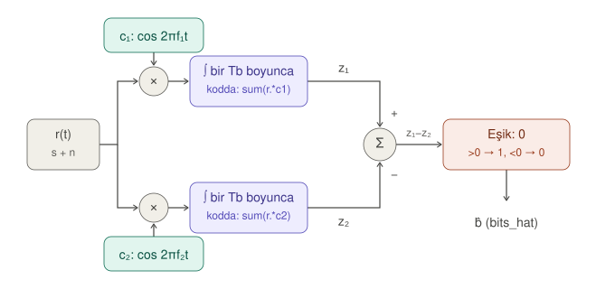

# BFSK – matematiksel model

## Verici

Her bit, $T_b$ süresince iki tondan biriyle gönderilir:

$$
s(t) = \begin{cases} A\cos(2\pi f_1 t), & b = 1 \\ A\cos(2\pi f_2 t), & b = 0 \end{cases} \qquad 0 \le t < T_b
$$

Bit enerjisi: $E_b = \int_0^{T_b} A^2\cos^2(2\pi f_i t)\,dt = A^2 T_b/2$.

**Ortogonallik şartı:** $(f_1 \pm f_2)\,T_b$ tam sayı ise

$$
\int_0^{T_b}\cos(2\pi f_1 t)\cos(2\pi f_2 t)\,dt = 0 .
$$

Repodaki `bfsk_mod` bunun temel bant karşılığını kullanır: bit 0 → $-\Delta f/2$, bit 1 → $+\Delta f/2$ tonu, $\Delta f = 1/T_b$ (sinyal $e^{j2\pi f t}$, ortalama örnek gücü 1).

## Alıcı (korelatör)

$$
z_1 = \int_0^{T_b} r(t)\cos(2\pi f_1 t)\,dt, \qquad z_2 = \int_0^{T_b} r(t)\cos(2\pi f_2 t)\,dt
$$

$A = 1$ alıp $r = s + n$ yazınca, örneğin bit 1 için:

$$
z_1 = E_b + n_1, \qquad z_2 = 0 + n_2, \qquad n_1, n_2 \sim \mathcal{N}\!\left(0, \tfrac{N_0 T_b}{4}\right)\ \text{(bağımsız)}
$$

**Karar:** $\hat b = 1$ eğer $z_1 - z_2 > 0$, aksi halde 0.

Ayrık zamanda (kod): $z_i = \sum_n r[n]\,c_i[n]$ (integralin $1/f_s$ çarpanı karşılaştırmayı değiştirmez).

## BER

| Alıcı | Teorik $P_b$ | Kodda |
|---|---|---|
| Koherent (faz biliniyor) | $Q\!\left(\sqrt{E_b/N_0}\right)$ | `bfsk_demod(r, sps, 'coherent')` |
| Non-koherent (zarf, $\lvert z_i\rvert$) | $\tfrac12 e^{-E_b/2N_0}$ | `bfsk_demod(r, sps, 'noncoherent')` |

Ortogonal BFSK, aynı $E_b/N_0$'da QPSK'dan 3 dB kötüdür: semboller arası uzaklık $\sqrt{2E_b}$, QPSK'da ise $2\sqrt{E_b}$.
