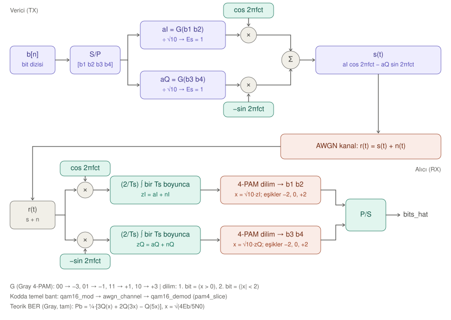

# 16-QAM – matematiksel model

## Verici

Bitler dörder gruplanır, $[b_1\ b_2\ b_3\ b_4]$ (k = 4, M = 16). Her eksen Gray kodlu bir 4-PAM'dir:

$$
G(00) = -3,\quad G(01) = -1,\quad G(11) = +1,\quad G(10) = +3
$$

$$
a_I = \frac{G(b_1 b_2)}{\sqrt{10}}, \qquad a_Q = \frac{G(b_3 b_4)}{\sqrt{10}}
$$

Ham noktaların ortalama enerjisi $\mathbb{E}[I^2] + \mathbb{E}[Q^2] = 5 + 5 = 10$, bu yüzden $\sqrt{10}$'a bölünür → $E_s = 1$, $E_b = E_s/4$.

Örnek: `1011` → $I = G(10) = +3$, $Q = G(11) = +1$ → $(3 + j)/\sqrt{10}$.

Bant geçiren sinyal ($T_s = 4T_b$):

$$
s(t) = a_I\cos(2\pi f_c t) - a_Q\sin(2\pi f_c t)
$$

## Alıcı

Korelatörler QPSK ile aynıdır: $z_I = a_I + n_I$, $z_Q = a_Q + n_Q$ (temel bantta $\mathrm{Re}\{r\}$, $\mathrm{Im}\{r\}$).

**Karar (ML = her eksende en yakın seviye):** $x = \sqrt{10}\,z_I$ (Q kolu için $\sqrt{10}\,z_Q$), eşikler $-2, 0, +2$:

$$
\hat b_{\text{1.}} = \begin{cases}1, & x > 0\\ 0, & x \le 0\end{cases}, \qquad
\hat b_{\text{2.}} = \begin{cases}1, & \lvert x\rvert < 2\\ 0, & \lvert x\rvert \ge 2\end{cases}
$$

(I kolu $b_1 b_2$'yi, Q kolu $b_3 b_4$'ü verir; kodda `pam4_slice`.)

## BER

Gray kodlu kare 16-QAM için tam ifade:

$$
P_b = \frac14\Big[3Q(x) + 2Q(3x) - Q(5x)\Big], \qquad x = \sqrt{\frac{4E_b}{5N_0}}
$$

Yüksek $E_b/N_0$'da yaklaşık $P_b \approx \tfrac34 Q\!\left(\sqrt{4E_b/5N_0}\right)$. QPSK'ya göre aynı BER için yaklaşık 4 dB daha fazla $E_b/N_0$ gerekir; karşılığında sembol başına 2 kat bit taşınır.

Kodda: `qam16_mod` → `awgn_channel` → `qam16_demod`, teori `ber_theory('qam16', ...)`.

Yıldız diyagramı: [constellations_gray.svg](../figures/constellations_gray.svg)
