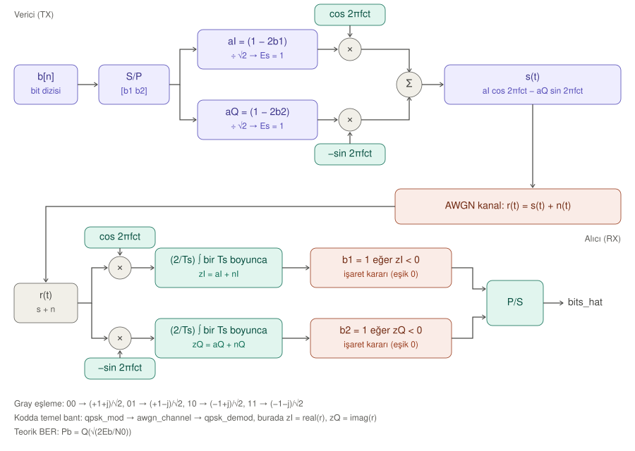

# QPSK – matematiksel model

## Verici

Bitler ikişer gruplanır, $[b_1\ b_2]$ (k = 2, M = 4). Gray eşleme:

$$
a_I = \frac{1 - 2b_1}{\sqrt2}, \qquad a_Q = \frac{1 - 2b_2}{\sqrt2}
$$

| $b_1 b_2$ | 00 | 01 | 10 | 11 |
|---|---|---|---|---|
| sembol $a_I + j a_Q$ | $\frac{1+j}{\sqrt2}$ | $\frac{1-j}{\sqrt2}$ | $\frac{-1+j}{\sqrt2}$ | $\frac{-1-j}{\sqrt2}$ |

Komşu noktalar tek bitte farklıdır. $\sqrt2$'ye bölmek $E_s = 1$, $E_b = E_s/2$ yapar.

Bant geçiren sinyal (bir sembol süresi $T_s = 2T_b$):

$$
s(t) = a_I\cos(2\pi f_c t) - a_Q\sin(2\pi f_c t), \qquad 0 \le t < T_s
$$

Temel bant karşılığı (repoda kullanılan): $s = a_I + j a_Q$, sembol başına 1 örnek.

## Alıcı

$\cos$ ve $-\sin$ ortogonal olduğu için iki kol birbirinden bağımsızdır:

$$
z_I = \frac{2}{T_s}\int_0^{T_s} r(t)\cos(2\pi f_c t)\,dt = a_I + n_I, \qquad
z_Q = \frac{2}{T_s}\int_0^{T_s} r(t)\,[-\sin(2\pi f_c t)]\,dt = a_Q + n_Q
$$

Temel bantta: $z_I = \mathrm{Re}\{r\}$, $z_Q = \mathrm{Im}\{r\}$.

**Karar (ML = işaret):**

$$
\hat b_1 = \begin{cases}1, & z_I < 0\\ 0, & z_I \ge 0\end{cases}, \qquad
\hat b_2 = \begin{cases}1, & z_Q < 0\\ 0, & z_Q \ge 0\end{cases}
$$

## BER

Her kol, enerjisi $E_b$ olan bir BPSK gibidir:

$$
P_b = Q\!\left(\sqrt{\frac{2E_b}{N_0}}\right)
$$

QPSK, BPSK ile aynı BER'i iki kat bit hızında verir. Kodda: `qpsk_mod` → `awgn_channel` → `qpsk_demod`, teori `ber_theory('qpsk', ...)`.

Yıldız diyagramı: [constellations_gray.svg](../figures/constellations_gray.svg)
