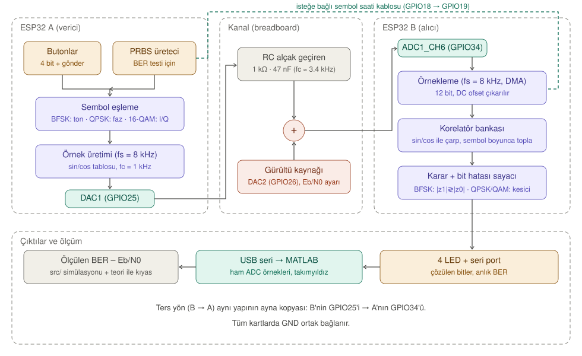
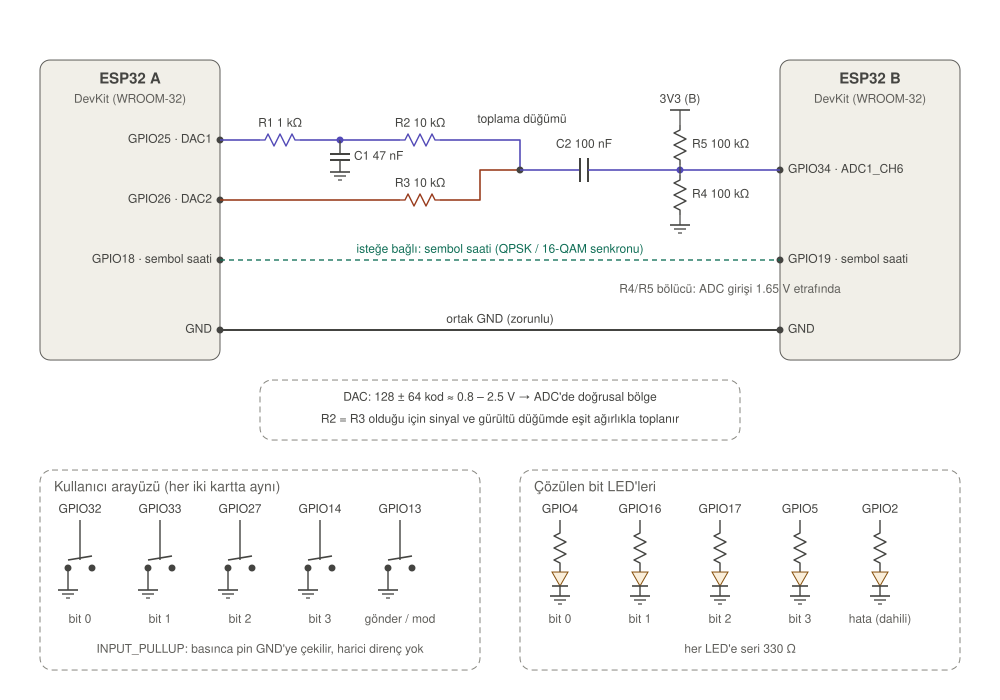
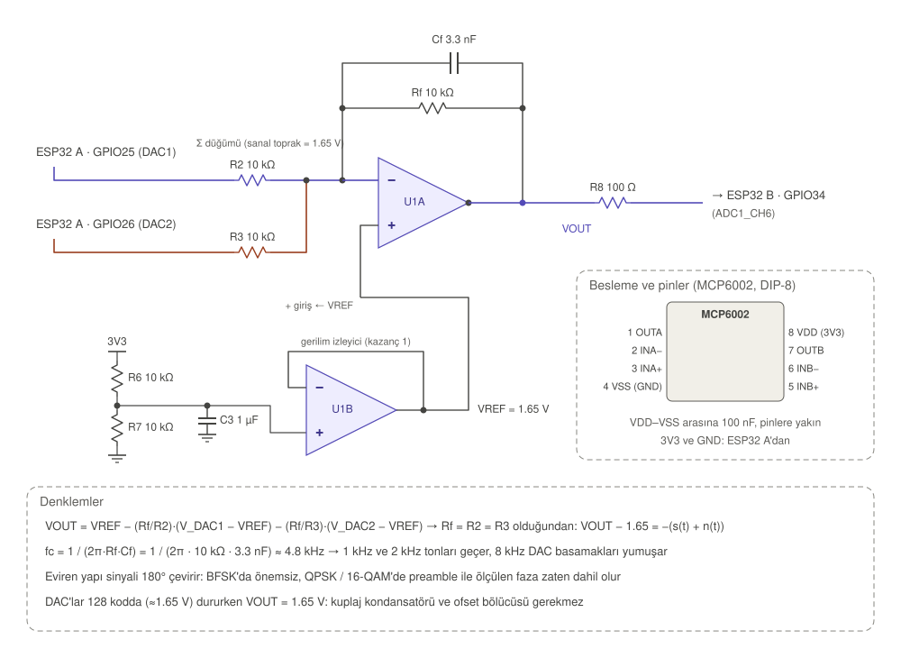

# hardware — ESP32 breadboard modem (plan)

> **Status: draft plan, not built yet.** Everything here (pins, part values, rates) is a starting point to think over before buying parts.

Since there are no ADALM-Pluto SDRs available, the hardware part of the project is now built with **two ESP32 boards on a breadboard**. Each board generates the BFSK / QPSK / 16-QAM waveform **itself** at a low (audio) frequency with its DAC, sends it over a jumper wire to the other board, and the other board samples it with its ADC and demodulates it. Bits can be entered with buttons (live demo) or come from a PRBS generator (BER measurement).

Why not WiFi / ESP-NOW: there the radio chip does the modulation, BFSK is not an option, and frames with errors are dropped by CRC, so we would see packet loss, not bit errors. Building our own modem over a wire puts the whole mod/demod chain in our own code.

## Block diagram

<picture>
  <source media="(prefers-color-scheme: dark)" srcset="sema/esp32_sistem_dark.svg">
  
</picture>

## Breadboard wiring

<picture>
  <source media="(prefers-color-scheme: dark)" srcset="sema/esp32_baglanti_dark.svg">
  
</picture>

Only one direction (A → B) is drawn. B → A is the mirror copy with a second MCP6002: B's GPIO25/26 → summer → A's GPIO34.

## Channel circuit: op-amp summer

<picture>
  <source media="(prefers-color-scheme: dark)" srcset="sema/esp32_opamp_dark.svg">
  
</picture>

One MCP6002 (dual op-amp, 3.3 V supply) per direction:

- **U1A, inverting summer:** adds the signal DAC (GPIO25) and the noise DAC (GPIO26) with gain −1 each. Rf ∥ Cf makes it a first-order low-pass at the same time, so no separate RC filter is needed.
- **U1B, voltage follower:** buffers the 1.65 V reference from the R6/R7 divider, so the summer's + input sees a stiff mid-supply voltage.
- Because the DACs idle at code 128 ≈ 1.65 V and the + input is also 1.65 V, the output sits at 1.65 V too. No coupling capacitor or extra bias divider is needed at the ADC.

`VOUT − 1.65 V = −(s(t) + n(t))`, `fc = 1/(2π·Rf·Cf) ≈ 4.8 kHz`

Op-amp choice and datasheet comparison: [`datasheets.md`](datasheets.md).

### Pin table (same on both boards)

| Pin | Use | Note |
|---|---|---|
| GPIO25 (DAC1) | Modulated signal out | 8-bit DAC, 0–3.3 V |
| GPIO26 (DAC2) | Noise out (for Eb/N0 sweep) | Pseudo-random samples, amplitude set in code |
| GPIO34 (ADC1_CH6) | Received signal in | Input-only pin; ADC1 because ADC2 does not work while WiFi is on |
| GPIO18 → GPIO19 | Optional symbol clock | Makes QPSK / 16-QAM timing sync easy |
| GPIO32, 33, 27, 14 | Buttons: bit 0–3 | `INPUT_PULLUP`, button to GND |
| GPIO13 | Button: send / change mode | Short press = send, long press = next scheme |
| GPIO4, 16, 17, 5 | LEDs: received bits 0–3 | 330 Ω in series |
| GPIO2 | Onboard LED: bit error | |
| GND | Common ground | **Required** between the boards |

### Part values (per direction)

| Part | Value | Why |
|---|---|---|
| U1 | MCP6002 (DIP-8) | Rail-to-rail in/out from 1.8 V, so it works on 3.3 V; breadboard-friendly package |
| R2, R3 | 10 kΩ, 10 kΩ | Summer inputs: signal and noise with equal weight |
| Rf, Cf | 10 kΩ, 3.3 nF | Gain −1, low-pass fc ≈ 4.8 kHz: passes the 1 and 2 kHz tones, smooths the 8 kHz DAC steps |
| R6, R7, C3 | 10 kΩ, 10 kΩ, 1 µF | 1.65 V reference, filtered |
| R8 | 100 Ω | Series resistor into the ADC pin (protection, isolates the ADC's sampling capacitor) |
| C4 | 100 nF | Supply decoupling, close to pins 8 and 4 |

Keep the signal + noise peak below about ±1.2 V around 1.65 V, so neither the op-amp output nor the ADC goes near its rails.

## Signal parameters (first guess)

| Parameter | Value |
|---|---|
| Sample rate fs | 8 kHz (timer interrupt on TX, ADC continuous / DMA on RX) |
| Symbol rate | 250 baud → 32 samples per symbol, Ts = 4 ms |
| Carrier fc | 1 kHz (QPSK, 16-QAM) |
| BFSK tones | 1 kHz and 2 kHz (spacing 1 kHz = 4/Ts, so they are orthogonal over a symbol) |
| DAC level | 128 ± 48 codes ≈ ±0.6 V around 1.65 V for the signal, leaving room for noise |
| Bit rate | BFSK 250 bit/s · QPSK 500 bit/s · 16-QAM 1000 bit/s |

Memory is not an issue: the ESP32 has 520 KB SRAM; a 256-entry sine table plus a few KB of sample buffer is all the modem needs.

## Scheme by scheme

| Scheme | TX (ESP32 A) | RX (ESP32 B) | Difficulty |
|---|---|---|---|
| BFSK | Pick 1 kHz or 2 kHz tone per bit | Two correlators, noncoherent `|z1| vs |z0|` (same as `src/bfsk_demod.m`) | Easy, works without sync |
| QPSK | One carrier, 4 phases (I/Q = ±1) | Multiply by cos and sin, sum over the symbol, sign decision | Medium: needs carrier phase and symbol timing (clock wire or preamble) |
| 16-QAM | I and Q each take 4 levels (Gray 4-PAM) | Same correlators + 4-level slicer per axis | Hard: needs amplitude calibration, most sensitive to ADC error |

Phase reference: the TX sends a known preamble (e.g. 16 symbols of `00`) at the start of each frame; the RX estimates the phase and amplitude from it and corrects the rest of the frame.

## Measuring BER

1. **Live demo:** set 4 bits with the buttons, press send → the bits show on the other board's LEDs.
2. **BER test:** TX sends a long PRBS (e.g. 10⁵ bits); RX knows the same sequence and counts errors.
3. **Eb/N0 sweep:** a clean wire gives almost no errors, so the noise DAC is turned up step by step. Eb/N0 is estimated from the measured signal and noise power at the ADC.
4. Raw ADC samples and error counts are sent over USB serial to MATLAB and plotted next to the simulation and theory from `src/`.

## Work plan

| Step | Goal | Target date |
|---|---|---|
| 0 | Order parts, decide on the plan as a team | 21 Nov |
| 1 | Make a tone with the DAC and read it with the ADC (one board, loopback) | 25 Nov |
| 2 | BFSK A → B, buttons + LEDs | 30 Nov |
| 3 | PRBS + BER counter + serial output to MATLAB, BFSK BER curve with the noise DAC | 6 Dec |
| 4 | QPSK with preamble (clock wire if needed) | 12 Dec |
| 5 | 16-QAM | 16 Dec |
| 6 | Both directions, final measurements, figures for the report | 20 Dec |

Final report: 22 Dec · Presentation: 5 Jan.

## Parts list

| Qty | Part |
|---|---|
| 2 | ESP32 DevKit (WROOM-32, the **classic ESP32**; S3 and C3 have no DAC) |
| 2 | Breadboard (830 points) |
| 10 | Tactile push button |
| 10 | LED + 330 Ω |
| 2 (+1 spare) | MCP6002-I/P (DIP-8), one per direction |
| 2 | DIP-8 socket (optional) |
| 15 | 10 kΩ |
| 2 | 100 Ω |
| 2 | 3.3 nF |
| 2 + 2 | 1 µF, 100 nF |
| 1 set | Male–male jumper wires |
| 2 | USB data cables |

## Open questions

- **Board choice: 2× ESP32 (3.3 V) or 2× Arduino UNO R4 (5 V)?** The UNO R4 (Minima / WiFi) has a 12-bit DAC on A0, a 14-bit ADC, a 48 MHz Cortex-M4 and 32 kB SRAM, and runs at 5 V. Its 12-bit DAC gives much cleaner 16-QAM levels than the ESP32's 8-bit DAC. It has only one DAC, so noise would be added in software or with PWM + RC. On 5 V the same MCP6002 circuit works with VREF = 2.5 V (OPA2340 and LM358 also work at 5 V; TL072 still does not). A classic UNO R3 has no DAC and only 2 kB RAM, so it would only be the button/LED interface. **Do not mix 5 V outputs with ESP32 inputs** (3.3 V pins) without a divider or level shifter.
- Do we use the clock wire, or try timing recovery from the preamble only?
- Arduino IDE or ESP-IDF? (Arduino is faster to start; ESP-IDF gives better DAC/ADC DMA control.)

## Folder layout

| Path | Contents |
|---|---|
| `sema/` | Block diagram, breadboard wiring and op-amp schematic (`.svg` + `_dark.svg`), and `sema_uret.py`, which regenerates them |
| `datasheets.md` | Op-amp comparison and datasheet links |
| `firmware/` | ESP32 code (to be added) |
