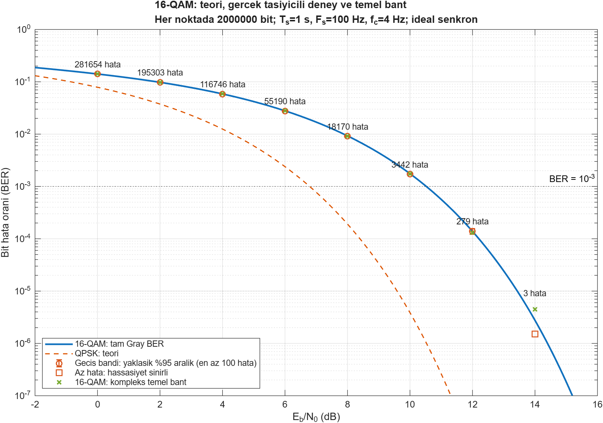
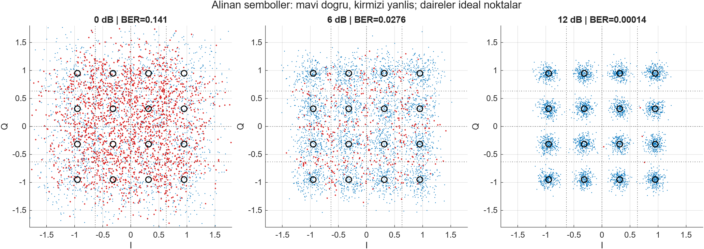
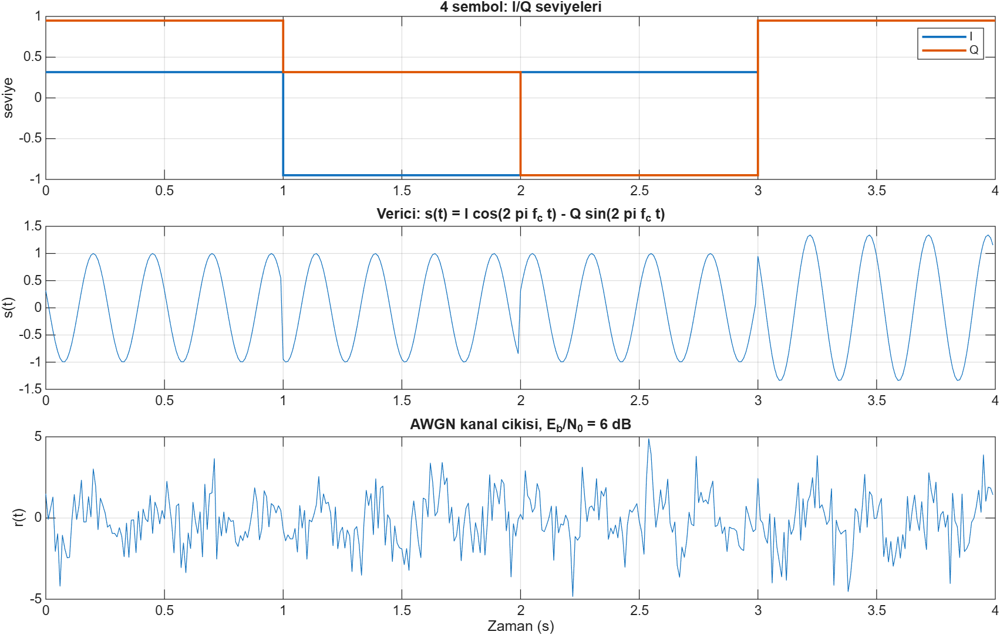

# 16-QAM doğrulama sonuçları

17 Kasım 2026'da MATLAB R2026b Prerelease Update 1 ile üretildi. Kod kaynağı `src/run_qam16_analysis.m`; her noktada 2 000 000 bit, Ts=1 s, Fs=100 Hz, fc=4 Hz, seed=451. Bunlar ideal senkronlu AWGN simülasyonlarıdır; fiziksel donanım ölçümü değildir.

| Eb/N0 | Hatalı bit | Ölçülen BER | Tam teorik BER |
|---|---:|---:|---:|
| 0 dB | 281654 | 0.140827 | 0.140982 |
| 4 dB | 116746 | 0.058373 | 0.058624 |
| 8 dB | 18170 | 0.009085 | 0.009247 |
| 12 dB | 279 | 0.0001395 | 0.0001387 |
| 14 dB | 3 | 0.0000015 | 0.0000028 |

14 dB'de yalnız üç hata sayıldı; bu noktanın hassasiyeti sınırlıdır. Grafikte yaklaşık %95 hata çubukları yalnız en az 100 hata bulunan noktalarda gösterilir; aynı sembolün bitleri arasındaki bağımlılık sembol bazında standart hata hesabıyla korunur. Noktalar ortak standart gürültü örnekleri kullandığı için birbirinden bağımsız tekrarlar değildir.

BER=10⁻³ için tam teorinin sayısal çözümü: **16-QAM 10.5224 dB**, **QPSK 6.7895 dB**, fark **3.7329 dB**. Bu hedefe ait teorik sonuçtur; her BER için sabit bir güç farkı değildir.







## Dosyalar ve tekrar üretme

- `qam16_ber.csv`: sekiz Eb/N0 noktasının tüm sayaçları, temel bant karşılaştırması ve standart hatalar.
- `qam16_results.mat`: sonuç tablosu, ayarlar ve teorik hedefler.
- `qam16_gui.png`: üç deney çalıştıktan sonraki arayüz görüntüsü.
- `qam16_ber.png`, `qam16_constellations.png`, `qam16_waveform.png`: yukarıdaki grafikler.

```matlab
% Proje kökünde:
addpath('src','gui')
test_mod_demod
test_qam16
run_qam16_analysis
f = qam16_gui(struct('Visible','off','AutoRun',true, ...
    'ExportDir',fullfile(pwd,'results','qam16')));
close(f)
```

Kontroller: 16 etiketin tamamı, Gray komşuluğu, Es=1 normalizasyonu, gürültüsüz gerçek dalgada sıfır hata, teorik BER, örnek ve korelatör gürültü varyansı, Fs/Ts değişiminde BER uyumu ve geçersiz ayarların reddi. Arayüzün üç deneyi çalıştırması ve sonuç yapısı gerçek MATLAB'de doğrulandı.
